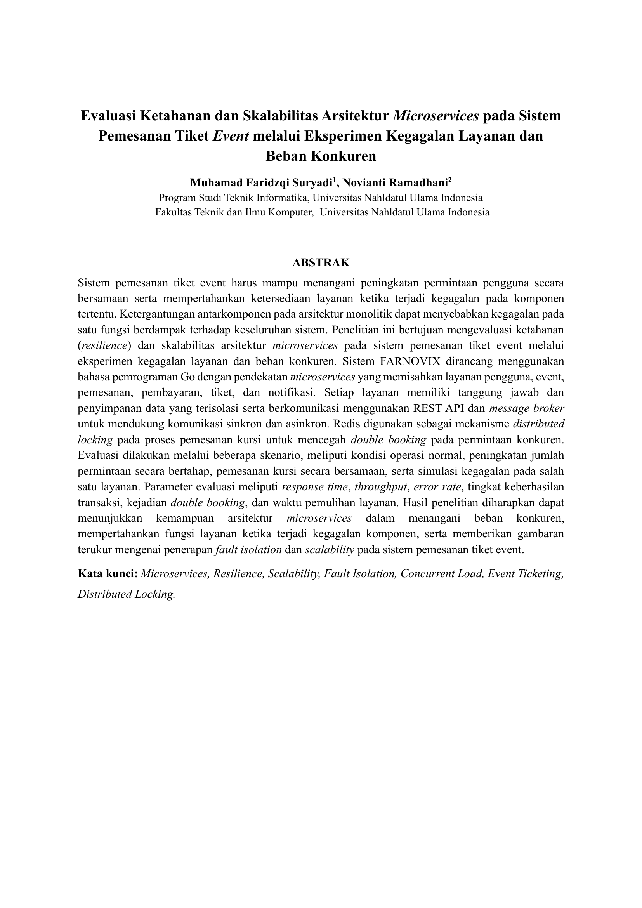
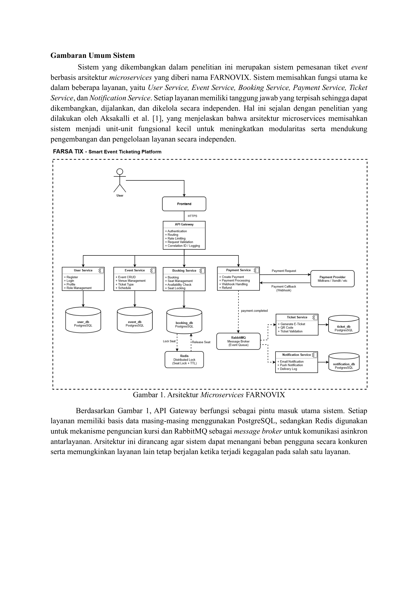
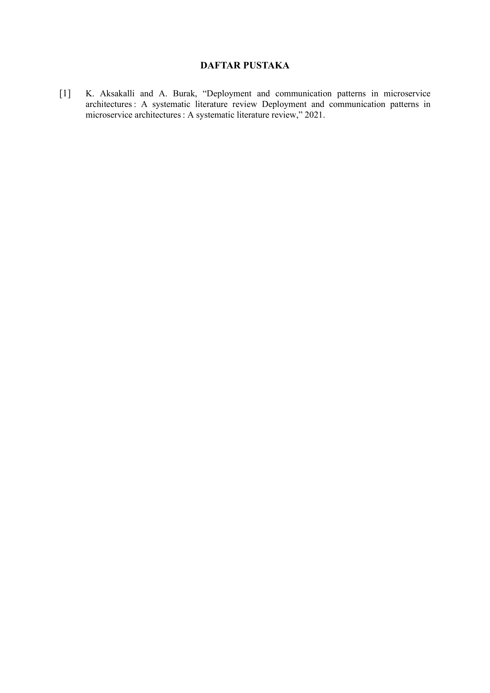

# Event Ticketing Platform

> **Research Title:** Evaluasi Ketahanan dan Skalabilitas Arsitektur Microservices pada Sistem Pemesanan Tiket Event melalui Eksperimen Kegagalan Layanan dan Beban Konkuren

A production-oriented microservices-based event ticketing system designed for research evaluation of resilience, scalability, fault isolation, and concurrent booking prevention.

### 📄 Pratinjau Dokumen Laporan

| Halaman 1 (Abstrak) | Halaman 2 (Arsitektur) | Halaman 3 (Daftar Pustaka) |
| :---: | :---: | :---: |
| [](docs/draft_1_farnovix.pdf) | [](docs/draft_1_farnovix.pdf) | [](docs/draft_1_farnovix.pdf) |

> 💡 *Klik salah satu gambar di atas untuk membuka dokumen PDF lengkap.*


## Architecture

| Service | Port | Database | Description |
|---------|------|----------|-------------|
| API Gateway | 8080 | — | Request routing, auth, rate limiting |
| User Service | 8081 | user_db | Registration, login, roles |
| Event Service | 8082 | event_db | Events, venues, tickets, seats |
| Booking Service | 8083 | booking_db | Seat locking, bookings |
| Payment Service | 8084 | payment_db | Payment processing (sandbox) |
| Ticket Service | 8085 | ticket_db | E-ticket generation |
| Notification Service | 8086 | notification_db | Async notifications |

**Infrastructure:** PostgreSQL 16, Redis 7, RabbitMQ 3, Prometheus, Grafana

## Quick Start

### Prerequisites

- Docker & Docker Compose

### Run

```bash
# Start the entire platform
docker compose up -d --build

# Check status
docker compose ps

# View logs
docker compose logs -f

# Stop
docker compose down

# Clean (removes volumes)
docker compose down -v --remove-orphans
```

### Test Event Service API

```bash
# Health check
curl http://localhost:8082/health

# Readiness check
curl http://localhost:8082/ready

# Create a venue
curl -X POST http://localhost:8082/api/v1/venues \
  -H "Content-Type: application/json" \
  -d '{"name":"Stadium A","address":"123 Main St","city":"Jakarta","capacity":5000}'

# Create an event (use venue_id from above)
curl -X POST http://localhost:8082/api/v1/events \
  -H "Content-Type: application/json" \
  -d '{"title":"Concert 2024","description":"Live concert","venue_id":"<VENUE_ID>","start_time":"2024-12-01T19:00:00Z","end_time":"2024-12-01T23:00:00Z"}'

# List events
curl http://localhost:8082/api/v1/events

# Get event by ID
curl http://localhost:8082/api/v1/events/<EVENT_ID>
```

## Project Structure

```
event-ticketing/
├── apps/                    # Microservices
│   ├── api-gateway/
│   ├── user-service/
│   ├── event-service/       # ✅ Phase 2 — Implemented
│   ├── booking-service/
│   ├── payment-service/
│   ├── ticket-service/
│   └── notification-service/
├── web/frontend/            # Next.js frontend
├── infrastructure/          # Docker, K8s, Prometheus, Grafana
├── tests/                   # Unit, integration, load, chaos
├── docs/                    # Architecture, API, ADR, research
├── docker-compose.yml
├── Makefile
└── README.md
```

## Development Phases

- [x] Phase 1: Repository + development environment
- [x] Phase 2: Event Service + PostgreSQL + Docker
- [ ] Phase 3: API Gateway
- [ ] Phase 4: User Service + Authentication
- [ ] Phase 5: Booking Service
- [ ] Phase 6: Redis Seat Lock
- [ ] Phase 7: Payment Service
- [ ] Phase 8: RabbitMQ integration
- [ ] Phase 9: Ticket Service
- [ ] Phase 10: Notification Service
- [ ] Phase 11: Frontend
- [ ] Phase 12: Integration testing
- [ ] Phase 13: Observability
- [ ] Phase 14: Security hardening
- [ ] Phase 15: Docker Compose production
- [ ] Phase 16: Kubernetes
- [ ] Phase 17: Load testing
- [ ] Phase 18: Failure/chaos testing
- [ ] Phase 19: Data analysis
- [ ] Phase 20: Research documentation

## License

MIT
