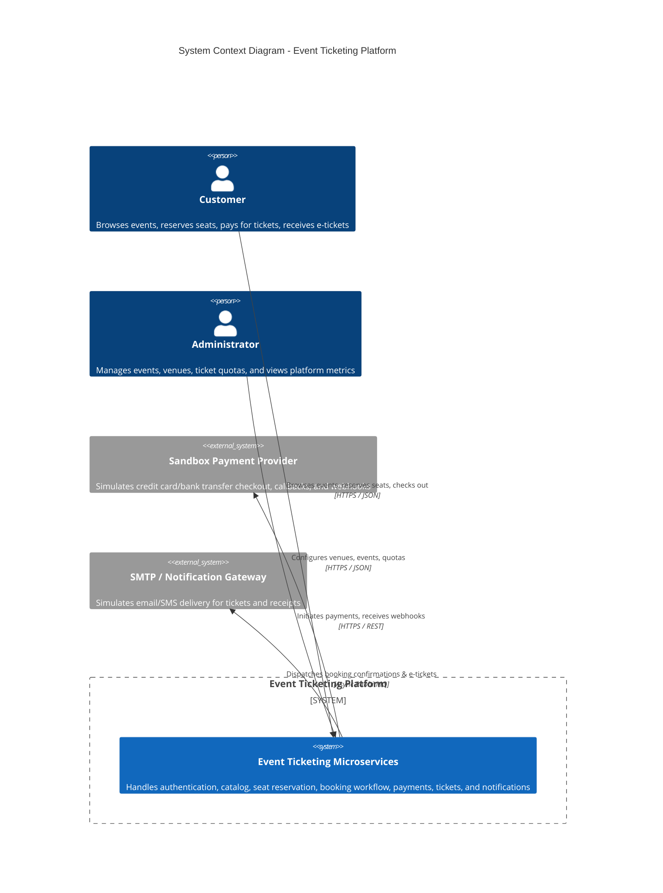

# System Context Diagram (C4 Model - Level 1)

## Overview

The Event Ticketing Platform is a high-concurrency microservices system for browsing events, reserving seats via distributed locking, and processing bookings and payments with asynchronous ticket issuance and notifications.

## Stakeholders & Users

1. **Customer**:
   - Authentication (Registration / Login / JWT)
   - Real-time event and seat browsing
   - High-concurrency seat locking (5-minute hold)
   - Booking and mock checkout
   - E-ticket retrieval with unique QR tokens

2. **Administrator**:
   - Venue management (capacities, layouts)
   - Event lifecycle (Draft, Published, Cancelled)
   - Ticket type pricing & quotas
   - System monitoring & metrics observation
